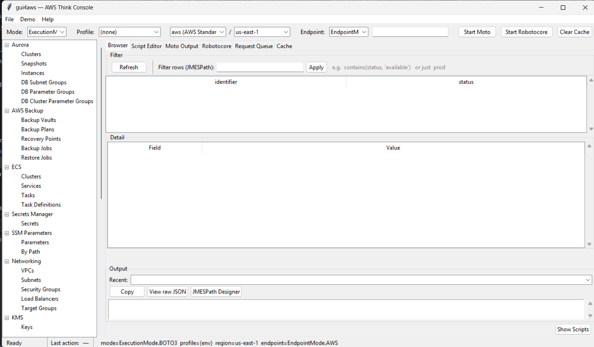

# gui4aws

gui4aws is a Tkinter desktop console for browsing and managing selected AWS resources. The toolbar keeps the profile, region, execution mode, and endpoint visible; resource panels show lists, details, and output. Actions can be inspected as generated CLI or Python scripts.



## Install and run

```bash
pipx install gui4aws
gui4aws
```

Or install with `python -m pip install gui4aws`. Run `gui4aws --help` for command-line options. The app uses normal AWS profile and environment credential sources; choose the intended profile, region, and target before running actions.

## What it offers

- Browse registered service panels, filter resource tables, and inspect output in one window.
- Choose boto3 or AWS CLI execution and AWS, managed Moto or Robotocore, or custom endpoints.
- Review write and cost affecting actions with generated scripts. Destructive actions require typed confirmation.
- Use the script editor and export action history as scripts.

Service panels have different levels of support. Some workflows still need the AWS Console or CLI; live AWS polish, service-specific correctness, and pagination coverage remain areas of work. Treat generated scripts as code to review before use, and use appropriate IAM permissions for the target account.

## Links

- [Homepage](https://matthewdeanmartin.github.io/gui4aws/)
- [Documentation](https://gui4aws.readthedocs.io/en/latest/)
- [Source and issues](https://github.com/matthewdeanmartin/gui4aws)
- [Changelog](CHANGELOG.md)
- [License](LICENSE) (MIT)
